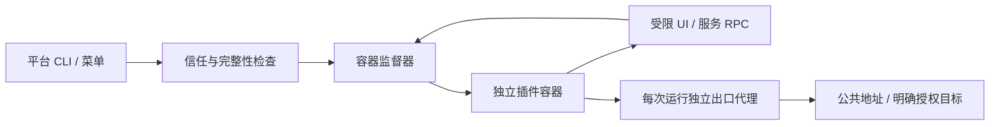

# OpsKit 平台与插件边界

官方软件管理、监控、网络、WireGuard、XUI、Tailscale 保留官方实现。`core/builtins.py` 是官方模块登记入口；第三方仓库通过 `plugin.yaml` 声明自身元数据，发现阶段不导入其 Python 代码。

## 职责

| 模块 | 职责 |
|---|---|
| `core/plugin.py` | 校验清单、发现元数据、创建入口代理 |
| `core/plugin_trust.py` / `plugin_integrity.py` | 内容指纹、人工授权、变更撤销 |
| `core/plugin_sandbox.py` | 容器生命周期、配额、权限检查、状态事务 |
| `core/plugin_worker.py` | 容器内 SDK 适配和 JSON RPC |
| `core/plugin_egress.py` | DNS 解析后地址检查、固定地址连接、出口授权 |
| `core/plugin_services.py` | 服务发现、调用方认证、代理 |
| `core/plugin_runtime.py` | 平台控制的运行时构建；不执行插件 Dockerfile |
| `plugin/cli.py` | 通用命令路由；不定义插件业务参数 |

## 数据与依赖

插件源码、插件状态、运行时目录独立。插件只能看到自身源码的只读快照和 `/data` 临时文件系统；平台的配置、虚拟环境、Docker socket 和宿主目录不挂载。宿主环境变量不转发。Python 插件依赖在独立运行时内安装，不修改平台虚拟环境。

状态提交限制 16 MiB、4096 文件，拒绝链接、特殊文件和越界路径。服务提供方状态按监督器认证的调用方分区；普通入口的 self 状态与 callers 状态是同级目录，避免自身入口看到其他调用方状态。进程内锁和跨进程文件锁串行化状态事务；循环服务调用及深度超过四层被拒绝。

## 安全边界和部署限制

非 root 容器、只读根文件系统、移除 capability、禁止新增权限，CPU/内存/PID/文件数/输出/时间配额。网络权限不意味着可访问宿主内网：插件只接入独立 internal 网络，通过代理访问公共地址；私有地址须操作方授权精确 `host:port`。插件禁用、内容变更和撤销信任会拒绝后续执行，并在运行中轮询停止。

Docker 与宿主内核仍是信任基础，容器不等同于虚拟机。生产应使用受维护的 rootless Docker 或独立执行节点，隔离其他工作负载；多租户恶意代码建议采用 gVisor、Kata 或微型虚拟机，并进行独立渗透测试。没有 Docker 时拒绝执行第三方插件，不降级到普通宿主子进程。

SDK API2 是跨进程契约，不能传递 Python 对象、函数回调或任意宿主文件路径。已有 API1 插件仅提供迁移兼容，不保证其所有原有宿主操作可用。

自更新在下载后及应用前验证 Ed25519 签名，签名绑定整数 build、平台资产文件名及 SHA256；拒绝低于或等于当前 build 的普通更新。公钥只能来自已安装程序或操作方本地可信配置，不能从下载文件取公钥。未配置公钥或缺少签名时拒绝自更新。发布方须配置 CI 公钥变量和私钥 secret，见 `docs/release-security.md`。初次安装脚本同样要求嵌入公钥并通过 OpenSSL 3 验证签名旁车，缺失工具或密钥时拒绝安装。生产密钥配置和正式发布仍需负责人完成。

## 发布内容

提交源码、测试、必要文档、配置示例、构建配置和依赖锁文件。运行缓存、凭据、真实配置、第三方 clone、运行时镜像目录、编辑器私人配置和生成产物不提交。忽略规则不影响已经跟踪的文件，也不能清除历史提交中的泄漏；如曾泄漏密钥，应撤销密钥并单独处理历史。
